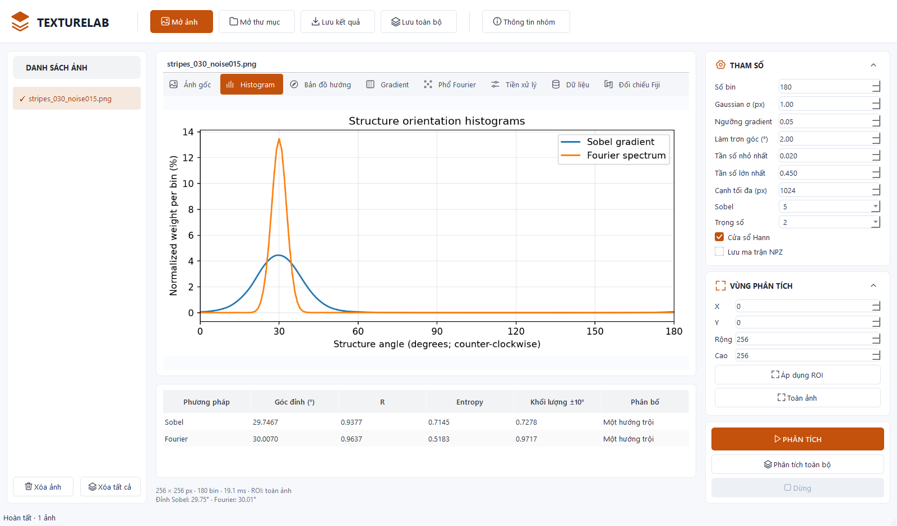

# TextureLab Desktop

Phân tích hướng và cấu trúc texture bằng Sobel gradient, histogram hướng và phổ Fourier. Ứng dụng gồm giao diện desktop Qt/PySide6 và CLI dùng chung lõi thuật toán.

## Thông tin đề tài

| Nội dung | Thông tin |
| --- | --- |
| Học phần | Xử lý ảnh |
| Giảng viên | TS. Nguyễn Tất Thắng |
| Nhóm lớp | 7 |
| Nhóm bài tập lớn | 2 |

| Thành viên | Mã sinh viên |
| --- | --- |
| Nguyễn Trung Kiên | B23DCCN464 |
| Phùng Trần Đức Long | B23DCCN508 |
| Phạm Xuân Minh | B23DCCN564 |
| Nguyễn Viết Vũ | B23DCCN946 |

## Tài liệu

- [Báo cáo](bao_cao/BAOCAO_BTL_XLA_NHOM_2.docx)
- [Slide PowerPoint](thuyet_trinh/TextureLab_Desktop_10_slides.pptx)
- [Slide PDF](thuyet_trinh/TextureLab_Desktop_10_slides.pdf)

## Chức năng

- Phân tích ảnh đơn và xử lý lô.
- Chọn ROI bằng chuột hoặc tọa độ.
- Điều chỉnh Gaussian, Sobel, ngưỡng gradient, histogram, dải tần và cửa sổ Hann.
- Hiển thị bản đồ hướng, gradient, phổ Fourier, histogram và các thống kê.
- Đối chiếu histogram với CSV của Fiji Directionality.
- Xuất CSV, JSON, PNG, HTML, NPZ và gói ZIP.



## Cài đặt và chạy

Python 3.11 trở lên. Môi trường đã kiểm chứng: Windows 11, Python 3.14.7. Các thư viện được khai báo trong [requirements.txt](requirements.txt); phiên bản Windows tại [requirements-windows-lock.txt](requirements-windows-lock.txt).

**Windows:** mở `run_windows.bat`, hoặc chạy tại thư mục dự án:

```powershell
py -3 -m venv .venv
.venv\Scripts\python.exe -m pip install -r requirements.txt
.venv\Scripts\python.exe app.py
```

**Linux / macOS:**

```sh
sh run_unix.sh
```

macOS chưa được kiểm chứng.

## Dòng lệnh

```powershell
.venv\Scripts\python.exe cli.py --help
.venv\Scripts\python.exe cli.py analyze data/samples/stripes_030_noise015.png --out results/single --save-arrays
.venv\Scripts\python.exe cli.py batch data/samples --out results/batch
.venv\Scripts\python.exe cli.py experiment --out results/reproduced_experiments
```

| Tham số | Mặc định |
| --- | --- |
| `--bins` | 180 |
| `--sigma` | 1 pixel |
| `--sobel` | 5 × 5 |
| `--threshold` | 0,05 |
| `--weight` | 2, tương ứng M² |
| `--hist-sigma` | 2° |
| `--rmin`, `--rmax` | 0,02–0,45 chu kỳ/pixel |
| Cửa sổ Hann | Bật; `--no-hann` để tắt |
| `--max-size` | 2048 pixel; desktop chọn sẵn 1024 |
| `--roi X Y W H` | Toàn ảnh; tọa độ trên ảnh gốc |

Đầu vào: PNG, JPG/JPEG, BMP, TIF/TIFF, WebP đơn khung; tối đa 20 MiB và 24 triệu pixel.

## Quy ước và kết quả

Góc cấu trúc thuộc miền [0°, 180°), đo ngược chiều kim đồng hồ; 0° nằm ngang, 90° thẳng đứng. Histogram chuẩn hóa theo tổng trọng số. R biểu thị độ tập trung theo một trục; entropy và các đỉnh phụ bổ sung thông tin về phân bố. Ảnh hằng có góc `null`.

| Tệp xuất | Nội dung |
| --- | --- |
| `summary.json` | Cấu hình, metadata, thống kê và cảnh báo |
| `histograms.csv` | Histogram thô và đã làm trơn |
| `input.png`, `preprocessed.png` | Ảnh trước và sau Gaussian |
| `gradient_magnitude.png` | Độ lớn gradient |
| `orientation_map.png`, `orientation_legend.png` | Bản đồ hướng và thang màu |
| `fft_spectrum.png` | Phổ log-công suất |
| `histogram.png`, `report.html` | Biểu đồ và báo cáo kết quả |
| `arrays.npz` | Mảng trung gian khi bật `--save-arrays` |

## Tham chiếu Fiji

Fiji được cài riêng, với JDK đi kèm. Thay `C:\Fiji.app` bằng đường dẫn cài đặt thực tế.

```powershell
.venv\Scripts\python.exe fiji/run_reference.py data/samples results/reproduced_fiji --fiji-home "C:\Fiji.app"
.venv\Scripts\python.exe tools/compare_reference_batch.py --images data/samples --reference results/reproduced_fiji
```

Tùy chọn `--demo` xuất ảnh cửa sổ plugin và cần màn hình. Khi không có `--fiji-home`, script sử dụng Java 17+ và các JAR trong [dependencies.json](fiji/dependencies.json).

Cấu hình đối chiếu: Gaussian σ = 1, 180 bin, miền 0–180°. CSV có hai cột `angle_deg,weight`. Histogram được căn chỉnh tuần hoàn; `Amount` của plugin và R của Python là hai đại lượng khác nhau.

## Kiểm thử và thực nghiệm

```powershell
.venv\Scripts\python.exe -m pip install -r requirements-dev.txt
.venv\Scripts\python.exe -m pytest
```

Kết quả Windows ngày 06/11/2026:

| Hạng mục | Kết quả |
| --- | --- |
| Kiểm thử | 63 đạt |
| Thực nghiệm chính | 240 lượt; 12 góc × 4 mức nhiễu × 5 seed; 192 ảnh khác nhau |
| Khảo sát Gaussian / số bin / Hann | 144 / 144 / 72 lượt |
| MAE tại σn = 0,30 | Sobel 0,9573°; Fourier 0,0703° |
| Tham chiếu | Directionality 2.3.0, ImageJ 1.54p; 15 ảnh |
| Đối chiếu có nhãn | 11 ảnh một hướng tính MAE; 14 ảnh có tín hiệu tính JSD |

Số liệu và nhật ký nằm trong [results/windows](results/windows). Thực nghiệm hiện giới hạn ở ảnh tổng hợp có nhãn. R nhỏ có thể xuất hiện ở ảnh nhiều hướng; gradient của các vân chồng nhau có thể khác hướng từng thành phần. Kết quả chưa xác nhận độ chính xác trên ảnh vật liệu tự nhiên.

## Cấu trúc dự án

| Đường dẫn | Nội dung |
| --- | --- |
| `app.py`, `desktop_ui.py` | Giao diện desktop và tác vụ nền |
| `cli.py` | Giao diện dòng lệnh |
| `texture/` | Thuật toán, đọc ảnh, xuất dữ liệu và thực nghiệm |
| `fiji/` | Mã gọi plugin và đối chiếu tham chiếu |
| `tools/` | Công cụ thực nghiệm và biên soạn tài liệu |
| `tests/` | Kiểm thử |
| `data/samples/` | Ảnh tổng hợp và nhãn |
| `results/` | Kết quả thực nghiệm |
| `bao_cao/`, `thuyet_trinh/` | Báo cáo và slide |

## Đóng gói

```powershell
.venv\Scripts\python.exe build.py
```

Cần cài `requirements-dev.txt` trước khi đóng gói. Trên Windows, đầu ra là thư mục `dist/TextureLab/` chứa `TextureLab.exe` và các thư viện đi kèm. Kho mã chưa kèm bản EXE đã biên dịch.

## Giấy phép

Mã độc lập của dự án theo [MIT License](LICENSE.txt). Ảnh tổng hợp theo CC0-1.0. Thư viện bên thứ ba giữ giấy phép riêng; Fiji Directionality theo GPLv3+.
